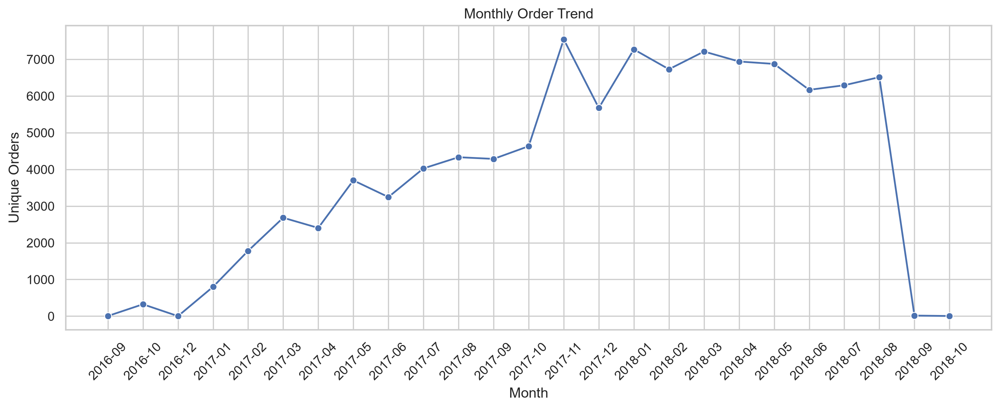
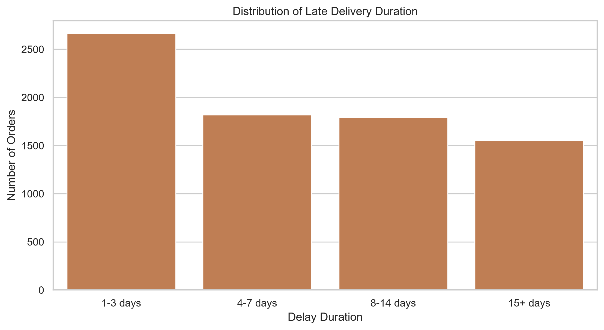
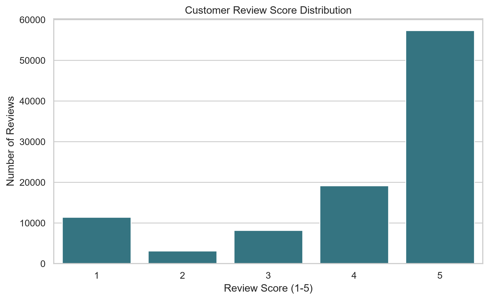
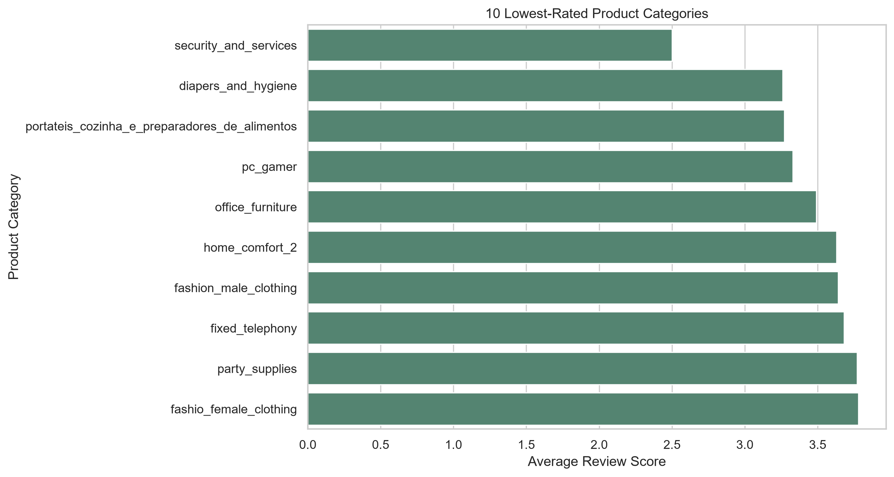
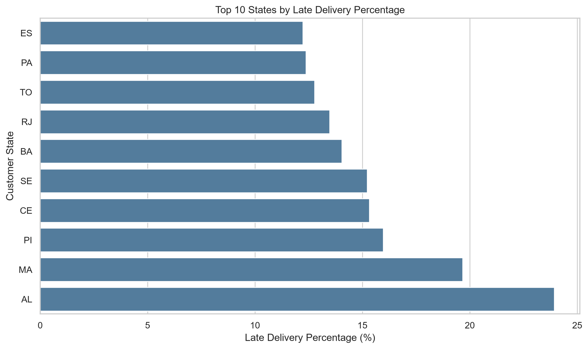

# E-Commerce Delivery & Customer Satisfaction Intelligence

## Project Overview
This project analyzes the Brazilian Olist e-commerce dataset to understand order delivery performance, customer satisfaction, monthly order trends, and product category performance.

The objective is to identify business problems, evaluate delivery delays, and generate actionable insights using Python data analysis techniques.

## Objectives
- Analyze overall order and delivery performance.
- Calculate late delivery percentage and average delivery time.
- Understand customer review score distribution.
- Identify product categories with lower customer ratings.
- Analyze monthly order trends.
- Compare delivery performance across customer states.
- Generate business findings and recommendations.

## Tools & Technologies
- Python
- Pandas
- NumPy
- Matplotlib
- Seaborn
- CSV datasets
- Visual Studio Code

## Key Performance Indicators (KPIs)
- Unique Orders: 99,441
- Delivered Orders with Valid Dates: 96,470
- Late Delivery Rate: 8.11%
- Average Delivery Time: 12.56 days
- Average Customer Review Score: 4.09/5

## Analysis Performed
1. Order and delivery analysis
2. Delivery delay distribution
3. Customer review score distribution
4. Monthly order trend analysis
5. Product category review analysis
6. State-wise delivery performance
7. Delivery performance versus customer satisfaction
8. Business findings and recommendations

## Project Structure
- `data/` — Source datasets
- `outputs/` — Generated CSV files and chart images
- `reports/` — Business findings and dataset notes
- `ecommerce_analysis.py` — Main Python analysis script
- `requirements.txt` — Required Python libraries
- `README.md` — Project documentation

## Installation & Execution

### 1. Install Python
Install Python and ensure it is available in your terminal.

### 2. Install Dependencies
Run this command from the project root directory:

```bash
python -m pip install -r requirements.txt
```

### 3. Run the Project

```bash
python ecommerce_analysis.py
```

### 4. Review Results
Check the `outputs/` folder for generated CSV files and charts, and the `reports/` folder for business findings.

## Business Recommendations
- Investigate operational causes of late deliveries.
- Review low-rated product categories and customer feedback.
- Plan fulfillment capacity around monthly order volumes.
- Monitor missing delivery timestamps when calculating KPIs.
- Evaluate delivery performance across states using sufficient sample sizes.

## Limitations
- The analysis identifies patterns and associations; it does not establish causation.
- Missing timestamps can affect delivery KPI calculations.
- Review comments and review scores are different types of information.
- Currency values remain in the source dataset's currency units.

## Conclusion
This project demonstrates practical data analysis using Python, including data processing, KPI calculation, exploratory analysis, visualization, and business recommendations.

**Skills demonstrated:** Data Cleaning, Exploratory Data Analysis (EDA), Pandas, NumPy, Data Visualization, KPI Analysis, and Business Reporting.
# E-Commerce Delivery & Customer Satisfaction Intelligence

## 📌 Project Overview

This project analyzes Brazilian e-commerce data to understand order trends, delivery performance, customer satisfaction, product categories, and business KPIs using Python.

## 🛠️ Tools & Technologies

- Python
- Pandas
- NumPy
- Matplotlib
- Seaborn
- VS Code

## 📊 Key Performance Indicators

| Metric | Result |
|---|---:|
| Unique Orders | 99,441 |
| Late Delivery Rate | 8.11% |
| Average Delivery Time | 12.56 days |
| Average Review Score | 4.09 / 5 |
| Late Delivery Review Score | 2.57 / 5 |
| On-Time/Early Review Score | 4.29 / 5 |

## 📈 Project Visualizations

### 1. Monthly Order Trend


### 2. Delivery Delay Distribution


### 3. Customer Review Score Distribution


### 4. Lowest-Rated Product Categories


### 5. State-Wise Delivery Performance


## 💡 Key Insights

- Approximately 8.11% of delivered orders were late.
- Average delivery time was 12.56 days.
- Late-delivered orders had an average review score of 2.57/5.
- On-time or early-delivered orders had an average review score of 4.29/5.

## ▶️ How to Run

1. Install the required libraries:

   ```bash
   python -m pip install -r requirements.txt
   ```

2. Run the analysis:

   ```bash
   python ecommerce_analysis.py
   ```

## 👨‍💻 Author

Soham Ghosalkar